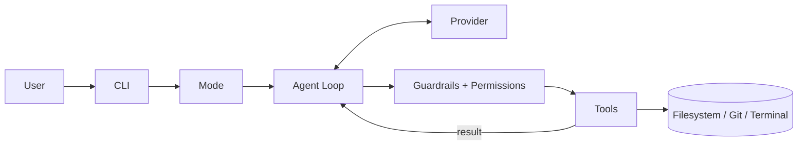

<div align="center">

# ANAS CLI

**Your codebase. Your rules.**

A multi-provider AI coding agent for the terminal. It explores your project, edits files, runs commands, and verifies its own work.


[Docs](#documentation) · [GitHub](https://github.com/JustenAnas/Anas-Code-CLI) · [npm](https://www.npmjs.com/package/anas-cli)

Built by [Anas](https://github.com/JustenAnas)

</div>

---

## Overview

ANAS CLI is an AI coding agent built from scratch in TypeScript. You describe a task in plain language; the agent explores the project, reads and changes files, runs terminal commands, checks the result, and recovers from errors, asking for your confirmation before anything dangerous.

It is not a chat window with a code box. The model gets real tools (file access, code search, git, shell) and works in a loop until the task is done.

> **Status:** early-stage and under active development. See [Limitations](#limitations).

## Features

| Feature | What it does |
|---|---|
| **Three modes** | `agent` (full coding), `ask` (read-only Q&A), `plan` (JSON plan, no changes) |
| **Agentic loop** | Native tool calling, with a text-based `<tool_call>` fallback. Capped at `MAX_ITERATIONS = 200` |
| **Multi-provider** | OpenAI, Anthropic Claude, Google Gemini, OpenRouter, Groq behind one `BaseProvider` interface and factory |
| **Streaming** | Responses stream as they are generated |
| **Verification loop** | After making changes, the agent checks its own work |
| **Error recovery** | Retry with exponential backoff on provider/tool failures |
| **Permission system** | `bash`, `write_file`, `edit_file` ask for confirmation before running |
| **Protected paths** | `.env`, `.git`, `node_modules`, `package.json` are blocked by default |
| **Guardrails** | Input/output checks: secret detection, prompt injection, destructive-command blocking, abusive-language filter |
| **History trimming** | Trims context while keeping assistant tool-call and tool-result pairs intact |
| **Cost tracking** | Per-turn token and cost line: `[X in · Y out · $cost]` |
| **Interactive chat** | Multi-turn sessions with slash commands |
| **Persistent config** | Provider and mode preferences saved between sessions |
| **Windows-friendly** | `bash` tool runs Windows CMD commands |

## Documentation

Docs site: **https://anas-cli.vercel.app/**  

## Installation

**Requirements:** Node.js (18+ recommended) and npm.

### From npm

```powershell
npm install -g anas-cli
anas --help
```

### From source

```powershell
git clone https://github.com/JustenAnas/Anas-Code-CLI.git
cd Anas-Code-CLI
npm install
```

## Configuration

Create a `.env` file in the project root and add keys for the providers you want to use. You only need one.

```env
OPENAI_API_KEY=your_key_here
ANTHROPIC_API_KEY=your_key_here
GEMINI_API_KEY=your_key_here
OPENROUTER_API_KEY=your_key_here
GROQ_API_KEY=your_key_here
```

Never commit `.env`. Provider and mode choices are saved automatically between sessions.

## Quick Start

```powershell
# Check that your environment is ready
anas doctor

# Start an interactive session
anas chat

# Or send a one-shot prompt
anas talk "Explain how the auth flow works in this project"
```

Running from source? Replace `anas` with `npx tsx src/index.ts`:

```powershell
npx tsx src/index.ts chat
npx tsx src/index.ts talk "Add input validation to the signup handler"
```

Run `anas <command> --help` to see the options for each command.

## Modes

| Mode | Purpose | Tools | Writes files |
|---|---|---|---|
| `agent` (default) | Complete coding tasks end to end | All | Yes, with confirmation |
| `ask` | Answer questions about the codebase | Read-only | No |
| `plan` | Produce a JSON implementation plan | None that modify files | No |

Switch modes inside a chat session:

```text
/mode ask
/mode plan
/mode agent
```

## Commands

| Command | Description |
|---|---|
| `anas hello` | Print a greeting |
| `anas wakeup [options]` | Banner, preflight checks, provider and mode selection, then chat |
| `anas chat [options]` | Interactive streaming chat session |
| `anas banner` | Show the welcome banner |
| `anas doctor` | Check environment readiness |
| `anas talk [options] <prompt>` | Send a one-shot prompt to the agent |
| `anas login` / `anas logout` | Cloud authentication |

### Slash commands (inside `chat`)

| Command | Description |
|---|---|
| `/help` | List available commands |
| `/mode` | Switch between agent, ask, plan |
| `/provider` | Switch AI provider |
| `/history` | Show conversation history |
| `/clear` | Clear the conversation |
| `/exit` | End the session |

## Tools

| Tool | Purpose | Confirmation |
|---|---|---|
| `read_file` | Read a file | No |
| `write_file` | Create or overwrite a file | **Yes** |
| `edit_file` | Modify part of a file | **Yes** |
| `bash` | Run a terminal command (Windows CMD) | **Yes** |
| `glob` | Find files by pattern | No |
| `list_dir` | List directory contents | No |
| `search_code` | Search inside files | No |
| `git` | Run git operations | No |

File tools use relative paths (`./src/index.ts`).

## Providers

| Provider | Environment variable | Notes |
|---|---|---|
| OpenAI | `OPENAI_API_KEY` | Primary provider (`gpt-4o`), native function calling |
| Anthropic Claude | `ANTHROPIC_API_KEY` | |
| Google Gemini | `GEMINI_API_KEY` | |
| OpenRouter | `OPENROUTER_API_KEY` | |
| Groq | `GROQ_API_KEY` | |

All providers implement the shared `BaseProvider` interface and are created through a factory, so adding one means implementing a single class.

## How It Works



1. You enter a request.
2. The model receives the conversation and the tools available in the current mode.
3. The model requests a tool call (native, or `<tool_call>` text fallback).
4. Guardrails and the permission layer check the operation; dangerous tools ask you first.
5. The tool runs and its result goes back to the model.
6. The loop continues until the task is done, verifying changes along the way.

## Safety

- **Confirmation:** `bash`, `write_file`, and `edit_file` require approval.
- **Protected paths:** `.env`, `.git`, `node_modules`, and `package.json` are blocked by default.
- **Guardrails:** secrets, prompt-injection attempts, and destructive commands are caught on input and output.
- **Ask and plan modes** never modify files.

Guardrails reduce risk; they do not eliminate it. Review confirmations before approving them.

## Windows Notes

The `bash` tool runs **Windows CMD** commands, so use CMD syntax (`dir`, `type`) rather than Unix commands (`ls`, `cat`). Examples in this README use PowerShell for installation only.

## Development

```powershell
npm install
npx tsx src/index.ts chat
```

Check `package.json` for the available build scripts.

## Limitations

- Early-stage project; expect rough edges.
- Primarily developed and tested on Windows.
- Provider behavior differs; OpenAI with native function calling is the most exercised path.
- No automated test suite is documented yet.

## Roadmap

Future ideas, **not yet implemented**:

- [ ] Web UI (Next.js, MongoDB auth, PostgreSQL + Prisma for sessions/history)
- [ ] Anas Agent SDK, a separate, reusable agent infrastructure
- [ ] More providers (DeepSeek, Grok, etc.)
- [ ] Memory and long-session context management

## Contributing

1. Fork the repository and create a branch.
2. Keep changes focused and match the existing TypeScript/ESM style.
3. Test your change by running the CLI locally.
4. Open a pull request describing what changed and why.

Issues and suggestions are welcome.

## License

MIT
