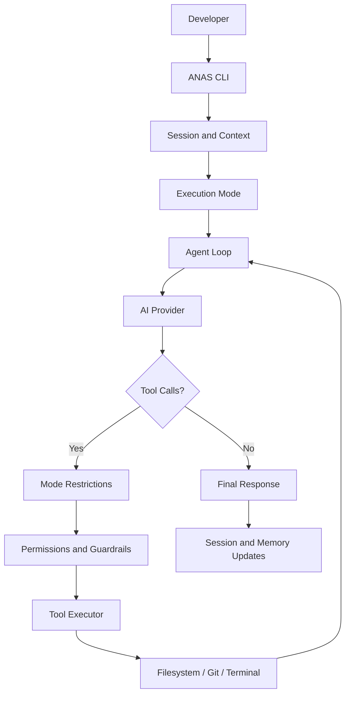

<div align="center">

# ANAS CLI

**Your codebase. Your rules.**

A multi-provider AI coding agent for the terminal. Explore your codebase, edit files, execute commands, and verify changes — with control over providers, permissions, and your workflow.

[](https://nodejs.org/)
[](https://www.typescriptlang.org/)
[](https://www.npmjs.com/package/anas-cli)
[](https://www.npmjs.com/package/anas-cli)
[](LICENSE)

[Documentation](https://anas-cli.vercel.app/) · [GitHub](https://github.com/JustenAnas/Anas-Code-CLI) · [npm](https://www.npmjs.com/package/anas-cli)

Built by [Anas](https://github.com/JustenAnas)

</div>

---

## Overview

ANAS CLI is an open-source, multi-provider AI coding agent built with **Node.js and TypeScript**.

Describe a task in natural language, and the agent can inspect your project, search source code, modify files, execute terminal commands, and use tool results to continue working toward a solution.

Unlike a traditional chatbot, ANAS CLI connects language models to real development tools through an agentic execution loop.

It supports multiple AI providers, configurable execution modes, permission controls, conversation sessions, cloud authentication, and persistent memory.

The goal is straightforward: **give developers an AI coding assistant without locking them into a single model or provider.**

> **Project status:** Early-stage and actively developed. Some features require additional end-to-end testing. See [Limitations](#limitations).

## Features

| Feature                      | Description                                                                                |
| ---------------------------- | ------------------------------------------------------------------------------------------ |
| **Three execution modes**    | Agent, Ask, and Plan, each with different tool permissions                                 |
| **Agentic execution loop**   | Multi-step reasoning, native tool calling, tool-result processing, and text-based fallback |
| **Multi-provider support**   | OpenAI, Anthropic Claude, Google Gemini, OpenRouter, and Groq                              |
| **Streaming responses**      | Display model output as it arrives                                                         |
| **Native function calling**  | Process multiple model-generated tool calls sequentially                                   |
| **Verification workflow**    | Instruct the agent to inspect and test changes before reporting completion                 |
| **Permission system**        | Request confirmation for sensitive operations                                              |
| **Protected paths**          | Restrict access to sensitive files and directories                                         |
| **Guardrails**               | Validate operations and reduce unsafe or unauthorized actions                              |
| **History management**       | Trim and compact conversation history                                                      |
| **Token and cost estimates** | Report token usage and estimated request costs                                             |
| **Interactive chat**         | Multi-turn conversations with slash commands                                               |
| **Cloud authentication**     | Authenticate with an ANAS Cloud account                                                    |
| **Cloud sessions**           | Persist conversations through a cloud API backed by a database                             |
| **Session restoration**      | Resume saved conversations using `/resume`                                                 |
| **Persistent memory**        | Store agent memory in the cloud independently of the AI provider                           |
| **Cloud-backed OpenAI**      | Use an OpenAI API key stored in ANAS Cloud                                                 |
| **Cloud rate limiting**      | Per-user request throttling                                                                |
| **Persistent configuration** | Remember provider and mode preferences                                                     |
| **Windows support**          | Execute commands using Windows CMD                                                         |

## Documentation

Full documentation is available at:

**https://anas-cli.vercel.app/**

The documentation covers installation, getting started, execution modes, AI providers, CLI commands, tools, permissions, and troubleshooting.

## Installation

### Requirements

- Node.js 18 or later
- npm
- At least one supported AI provider API key, configured locally or through a supported cloud workflow

### Install from npm

```powershell
npm install -g anas-cli
```

Verify the installation:

```powershell
anas --help
```

### Install from source

```powershell
git clone https://github.com/JustenAnas/Anas-Code-CLI.git
cd Anas-Code-CLI
npm install
```

Start the CLI:

```powershell
npx tsx src/index.ts chat
```

## Configuration

ANAS CLI supports local API keys and cloud-backed OpenAI authentication.

### Local API keys

Create a `.env` file in the project root.

```env
OPENAI_API_KEY=your_openai_key
ANTHROPIC_API_KEY=your_anthropic_key
GEMINI_API_KEY=your_gemini_key
OPENROUTER_API_KEY=your_openrouter_key
GROQ_API_KEY=your_groq_key
```

You only need to configure the providers you intend to use.

**Never commit API keys, credentials, or `.env` files to version control.**

### ANAS Cloud

ANAS Cloud provides account authentication and cloud-backed functionality.

Available cloud features include:

- Authenticated CLI requests
- Provider-key storage
- Cloud-backed OpenAI requests
- Conversation session persistence
- Saved message history
- Persistent agent memory

When an `OPENAI_API_KEY` environment variable is available, ANAS CLI uses the local OpenAI provider.

Otherwise, the provider factory selects the cloud-backed OpenAI implementation.

Cloud OpenAI requires authentication and a saved OpenAI API key.

## Quick Start

### Check your environment

```powershell
anas doctor
```

### Start interactive chat

```powershell
anas chat
```

### Run the guided setup

```powershell
anas wakeup
```

### Execute a one-shot request

```powershell
anas talk "Explain how authentication works in this project"
```

### Run from source

```powershell
npx tsx src/index.ts chat
```

```powershell
npx tsx src/index.ts talk "Add input validation to the signup handler"
```

Run `anas <command> --help` to inspect available command options.

## Execution Modes

ANAS CLI provides three execution modes.

| Mode    | Purpose                         | Tool access         | File modifications          |
| ------- | ------------------------------- | ------------------- | --------------------------- |
| `agent` | Complete coding tasks           | All permitted tools | Yes, subject to permissions |
| `ask`   | Explore and understand code     | Read-only tools     | No                          |
| `plan`  | Generate an implementation plan | No tools            | No                          |

### Agent mode

Agent mode provides access to the complete tool system.

The agent can inspect files, search code, propose modifications, execute permitted commands, and verify its work.

Sensitive operations are subject to permission checks and guardrails.

### Ask mode

Ask mode is designed for codebase exploration and technical questions.

Available tools:

- `read_file`
- `search_code`
- `glob`
- `list_dir`

Write operations and command execution are not available.

### Plan mode

Plan mode generates a structured implementation plan without executing tools or modifying files.

The agent returns a JSON plan containing actionable steps.

### Switch modes

Inside an interactive session:

```text
/mode ask
/mode plan
/mode agent
```

## CLI Commands

| Command              | Description                         |
| -------------------- | ----------------------------------- |
| `anas hello`         | Display a greeting                  |
| `anas wakeup`        | Launch the guided startup workflow  |
| `anas chat`          | Start an interactive coding session |
| `anas talk <prompt>` | Execute a one-shot prompt           |
| `anas doctor`        | Check environment readiness         |
| `anas banner`        | Display the CLI banner              |
| `anas login`         | Authenticate with ANAS Cloud        |
| `anas logout`        | Sign out of ANAS Cloud              |

### Interactive slash commands

| Command     | Description                                          |
| ----------- | ---------------------------------------              |
| `/help`     | Display available commands                           |
| `/mode`     | Change the execution mode                            |
| `/provider` | Change the AI provider, where supported              |
| `/history`  | Inspect conversation history                         |
| `/resume`   | Restore an existing session                          |
| `/new`      | Create a new session                                 |
| `/clear`    | Clear conversation context                           |
| `/context`  | Show message count and estimated conversation tokens |
| `/paste` | Write a prompt using Notepad                            |
| `/exit`     | Exit interactive chat                                |

Some commands may depend on the current CLI version.

## Tools

ANAS CLI exposes development tools through a shared execution interface.

| Tool          | Description                          | Permission            |
| ------------- | ------------------------------------ | --------------------- |
| `read_file`   | Read file contents                   | Read-only             |
| `write_file`  | Create or overwrite files            | Confirmation required |
| `edit_file`   | Replace exact text in existing files | Confirmation required |
| `bash`        | Execute terminal commands            | Confirmation required |
| `glob`        | Find files using patterns            | Read-only             |
| `list_dir`    | List directory contents              | Read-only             |
| `search_code` | Search source code contents          | Read-only             |
| `git`         | Inspect Git repository state         | Read-only operations  |

### Tool execution

Tool calls are processed by the agent loop.

The execution process includes:

1. Check whether the requested tool is allowed in the current mode.
2. Apply permission checks and relevant guardrails.
3. Execute the tool.
4. Return the actual tool result to the model.
5. Continue the agent loop using the result.

Multiple native tool calls are processed sequentially to avoid conflicting file operations.

Tool output is treated as untrusted data.

### Workspace boundaries

File operations are restricted to the configured workspace.

Relative paths resolve from the workspace directory.

Absolute paths can be used when they point inside the permitted workspace.

Paths outside the workspace are rejected by the tool layer.

## AI Providers

ANAS CLI uses a shared `BaseProvider` interface.

| Provider         | Environment variable | Notes                          |
| ---------------- | -------------------- | ------------------------------ |
| OpenAI           | `OPENAI_API_KEY`     | Local or cloud-backed provider |
| Anthropic Claude | `ANTHROPIC_API_KEY`  | Claude models                  |
| Google Gemini    | `GEMINI_API_KEY`     | Gemini models                  |
| OpenRouter       | `OPENROUTER_API_KEY` | Configurable model selection   |
| Groq             | `GROQ_API_KEY`       | Groq-hosted models             |

Each provider implements the common messaging interface.

```ts
interface BaseProvider {
  name: string;

  sendMessage(
    messages: Message[],
    systemPrompt?: string,
  ): Promise<ProviderResponse>;

  streamMessage(
    messages: Message[],
    onChunk: (chunk: string) => void,
    systemPrompt?: string,
  ): Promise<ProviderResponse>;
}
```

This abstraction allows the agent loop to operate independently of the selected AI provider.

Provider-specific API behavior, model capabilities, and pricing may differ.

## How It Works



The agent follows an iterative workflow:

1. Receive the developer's request.
2. Assemble the conversation, project context, execution environment, and available memory.
3. Send the request to the selected AI provider.
4. Receive a response or native tool calls.
5. Validate requested operations against the current mode.
6. Execute permitted tools and collect results.
7. Return tool results to the model.
8. Repeat until the task finishes or the execution limit is reached.

The agent loop includes an iteration cap to prevent unlimited execution.

## Conversation Sessions

ANAS CLI supports multi-turn conversations.

Each session contains:

- A unique session identifier
- Creation and update timestamps
- Conversation messages
- Associated agent memory

### Cloud session persistence

Authenticated users can synchronize sessions with ANAS Cloud.

Cloud session records are associated with the authenticated account.

Messages are saved using unique local message identifiers, allowing the backend to update existing records rather than create duplicates during synchronization.

### Resume conversations

The `/resume` command can restore a previous conversation.

For cloud sessions, the CLI retrieves stored messages and reconstructs the local conversation state.

This is designed to preserve conversation continuity across CLI restarts.

> Cloud persistence and restart restoration are implemented in the reviewed code paths; full end-to-end restart testing remains a separate verification step.

## Persistent Agent Memory

ANAS CLI includes a provider-independent memory system.

Unlike conversation history, memory is intended to preserve useful information across interactions.

Examples include:

- Developer preferences
- Project conventions
- Long-term architectural decisions
- Repeated workflow requirements
- Important development constraints

### Cloud memory

The cloud memory implementation stores structured memory under an account-specific key.

Memory can be retrieved independently of the selected AI provider.

The memory manager uses the selected provider to evaluate which information should be preserved, updated, or removed.

The agent can include available memory in its system prompt.

### Provider-independent design

Memory is stored separately from provider-specific SDKs.

The intended behavior is that memories created while using one provider remain available when switching to another provider, including OpenAI, Claude, Gemini, Groq, and OpenRouter models.

> Cloud memory storage and provider-independent architecture are implemented. Startup loading and cross-provider persistence still require end-to-end verification.

## Streaming and Tool Calling

ANAS CLI supports streaming model responses.

Where supported, providers return structured native tool calls.

The agent also retains compatibility with a legacy text-based tool-call parser.

### Cloud OpenAI

The cloud-backed OpenAI provider communicates with the ANAS Cloud API.

The API:

- Authenticates the CLI user
- Retrieves the user's encrypted provider key
- Sends requests to OpenAI
- Supports streaming responses
- Returns native tool-call information
- Reports token usage when available

Tool execution remains inside the local CLI agent, where mode restrictions and permissions are applied.

## Error Handling

ANAS CLI includes provider error handling and retry behavior.

Implemented mechanisms include:

- Structured provider errors
- HTTP status propagation for non-streaming cloud request failures
- Retryable error classification
- Exponential backoff
- Insufficient-credit detection
- Cloud authentication error responses
- Rate-limit error handling
- Incomplete cloud-stream detection
- Tool execution error reporting

Provider-specific failures may require different recovery behavior.

Interrupted streams and certain API error scenarios remain areas for additional testing.

## Usage and Cost Tracking

ANAS CLI can report token usage and estimated request costs.

Example:

```text
[1,250 in · 480 out · $0.0079]
```

Actual costs depend on the provider, model, token usage, and applicable pricing.

The current agent loop contains a fixed pricing estimate, so reported costs should not be treated as authoritative billing figures across all providers.

### Cloud rate limiting

The cloud provider-chat endpoint includes per-user rate limiting.

Current configured limit:

**30 requests per minute per authenticated user.**

The limiter uses MongoDB to maintain request counts within time windows.

Requests exceeding the limit receive HTTP `429` responses.

### Spending limits

Rate limiting reduces request frequency but does not guarantee a maximum monetary spend.

Per-user cloud usage accounting and configurable spending limits are planned improvements.

## Safety and Security

ANAS CLI uses multiple layers of controls to reduce unintended operations.

### Permission controls

Sensitive tools such as `bash`, `write_file`, and `edit_file` are subject to permission checks.

### Protected files

The guardrail system restricts access to sensitive paths, including:

- `.env` and related environment files
- Private keys and certificate files
- Credential and secret files
- `.git`
- `node_modules`

Package manifests and lockfiles may receive additional restrictions.

### Tool restrictions

Tool availability is determined by execution mode.

Ask mode permits only read-only tools.

Plan mode does not execute tools.

### Prompt-injection protection

Tool results and project content are treated as untrusted reference material.

Instructions discovered inside files or command output must not override the user's request or the agent's higher-priority instructions.

### Cloud security

The cloud implementation includes:

- Authenticated requests
- User-scoped session and memory records
- Encrypted provider-key storage
- Request validation
- Request-size limits
- Per-user rate limiting

> Security controls reduce risk but cannot guarantee complete protection. Review requested operations before approving them.

## Windows Notes

ANAS CLI is primarily developed and tested on Windows.

The `bash` tool uses Windows CMD.

Use Windows-compatible commands:

```cmd
dir
type package.json
mkdir src\components
```

Avoid Unix-specific syntax when operating through the Windows CMD tool.

Installation examples in this README use PowerShell.

## Development

Clone the repository:

```powershell
git clone https://github.com/JustenAnas/Anas-Code-CLI.git
cd Anas-Code-CLI
npm install
```

Start the development CLI:

```powershell
npx tsx src/index.ts chat
```

Check `package.json` for available build, development, and verification scripts.

### Project structure

Selected source directories:

```text
src/
├── agent/
│   ├── loop.ts
│   ├── memory.ts
│   ├── session.ts
│   ├── session-store.ts
│   ├── guardrails.ts
│   └── tool-executor.ts
├── cloud/
│   └── client.ts
├── command/
│   └── chat.ts
├── providers/
│   ├── base.ts
│   ├── factory.ts
│   ├── openai.ts
│   ├── cloud-openai.ts
│   ├── claude.ts
│   ├── gemini.ts
│   ├── openrouter.ts
│   └── groq.ts
└── index.ts
```

The Next.js application provides documentation and cloud API functionality.

## Limitations

ANAS CLI remains an early-stage project.

Current limitations include:

- Primarily developed and tested on Windows.
- Provider behavior varies by model and API.
- Cloud-backed provider-key fallback currently focuses on OpenAI.
- Cloud session restoration requires additional end-to-end restart testing.
- Cross-provider cloud memory behavior requires additional verification.
- Streaming interruptions and provider-specific errors need broader testing.
- Token cost calculations are estimates and are not model-specific across all providers.
- Per-user monetary spending limits are not yet implemented.
- No comprehensive automated test suite is documented.

## Roadmap

Planned improvements and future ideas:

- [x] Multi-provider architecture
- [x] Native tool calling
- [x] Ask, Agent, and Plan modes
- [x] Workspace-aware tools
- [x] Permission and guardrail system
- [x] Interactive sessions
- [x] Cloud authentication
- [x] Cloud session persistence
- [x] Cloud memory storage
- [x] Cloud-backed OpenAI integration
- [x] Groq provider support
- [x] Cloud request rate limiting
- [ ] Complete end-to-end cloud session and memory tests
- [ ] Improve interrupted-stream recovery
- [ ] Add provider-specific usage pricing
- [ ] Add per-user cloud usage accounting
- [ ] Add configurable spending limits
- [ ] Expand the web application experience
- [ ] Improve agent verification reliability
- [ ] Expand automated testing
- [ ] Add more AI providers
- [ ] Develop the separate Anas Agent SDK

## Contributing

Contributions, bug reports, and feature suggestions are welcome.

1. Fork the repository.
2. Create a feature branch.
3. Keep changes focused and follow the existing TypeScript/ESM conventions.
4. Test changes locally.
5. Open a pull request explaining the change and its purpose.

Please avoid unrelated refactoring when contributing fixes.

## License

Distributed under the MIT License.

See [LICENSE](LICENSE) for details.

---

<div align="center">

**ANAS CLI — Your codebase. Your rules.**

[Documentation](https://anas-cli.vercel.app/) · [GitHub](https://github.com/JustenAnas/Anas-Code-CLI) · [npm](https://www.npmjs.com/package/anas-cli)

</div>
